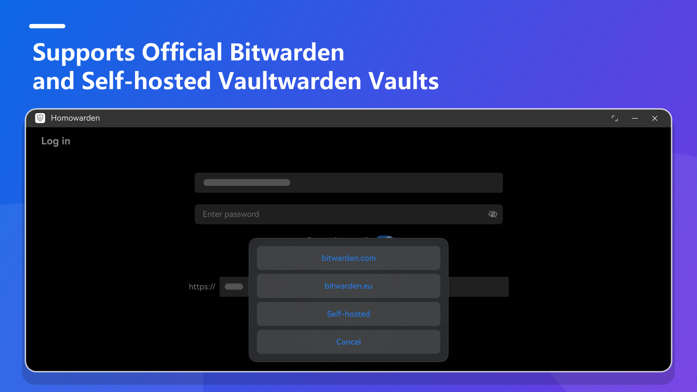
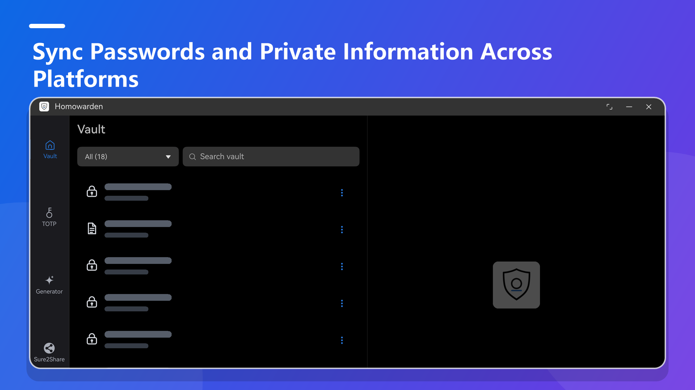
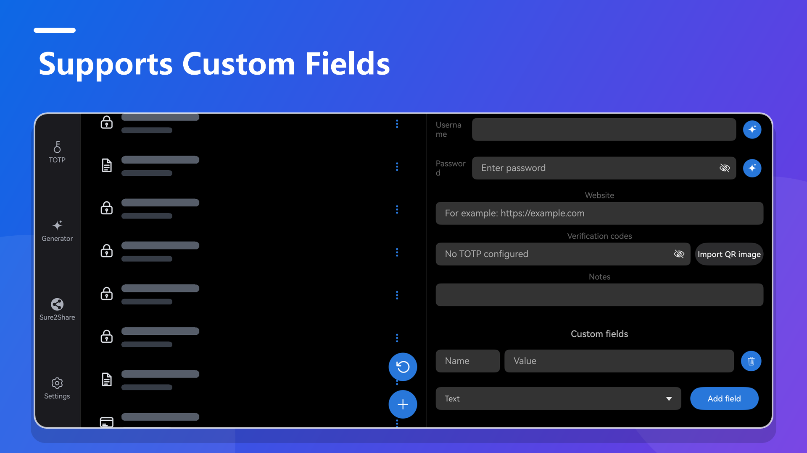
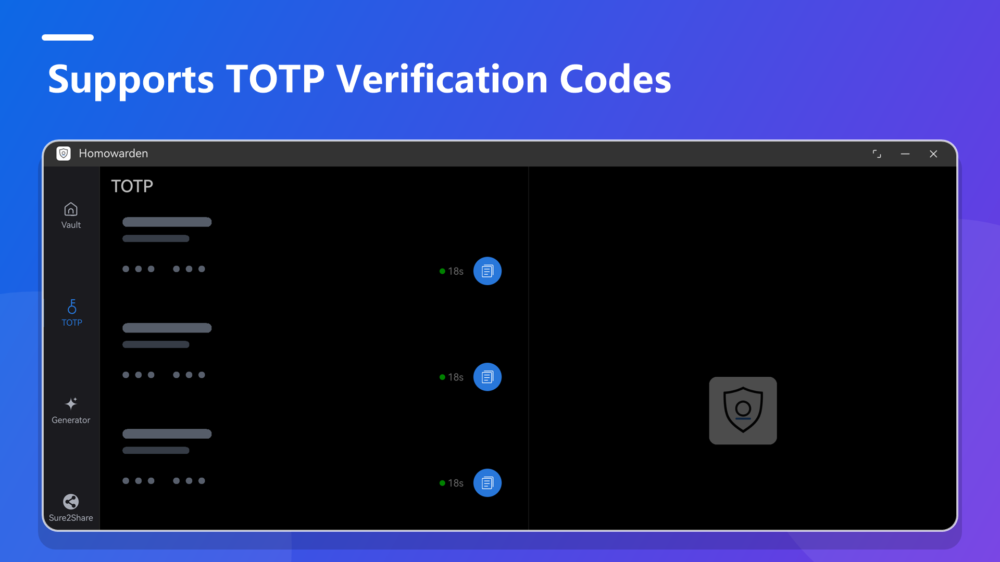
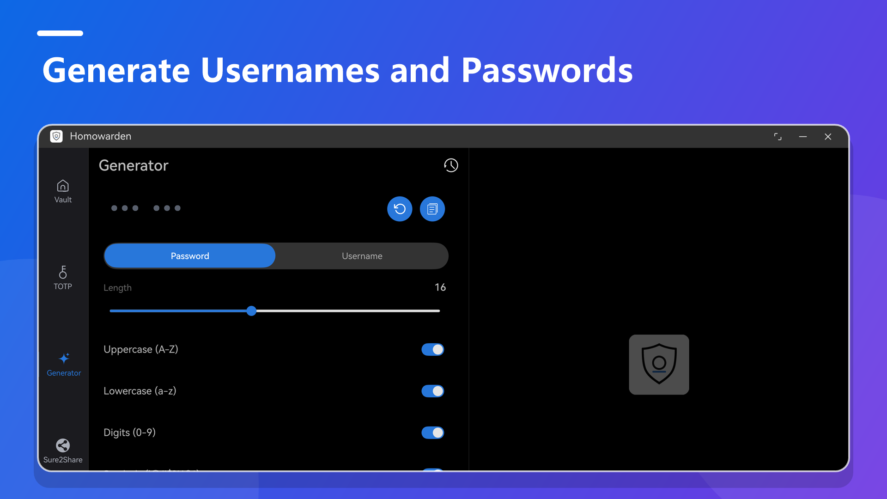
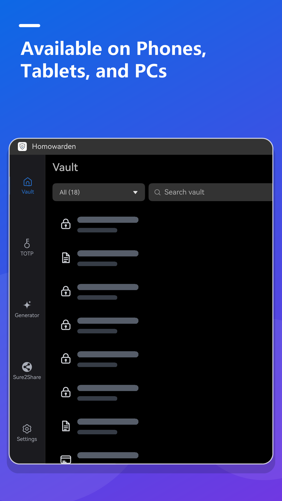

# Homowarden

[中文](README.md) | [English](README.en.md)

Homowarden is an unofficial Bitwarden client for HarmonyOS, written in ArkTS. It runs on phones, tablets, and PCs, works with official and self-hosted servers, and keeps vault data end-to-end encrypted.

**Note:** Keys are stored in the system asset store and are **not** removed when the app is uninstalled. Sign out from Settings before uninstalling.

Homowarden is available on Huawei AppGallery:

<a href="https://appgallery.huawei.com/app/detail?id=com.dreamist.homowarden&channelId=SHARE&source=appshare" target="_blank"></a>

## Features

### Account and authentication

- Supports `bitwarden.com`, `bitwarden.eu`, and self-hosted Bitwarden servers
- Supports two-step verification and new-device email verification



### Vault

- Syncs the vault from the server into a local encrypted database
- Supports logins, secure notes, cards, and identities
- Supports create, view, edit, delete, restore from trash, and permanent delete
- Supports favorites, custom fields, multiple URIs, and master-password re-prompt
- Supports type, favorite, and trash filters, plus keyword search
- Supports quick copy for username, password, TOTP, and other common fields





### TOTP

- Shows live codes in item details and in a dedicated list
- Parses `otpauth://` links and extracts secrets
- Supports QR scanning
- On 2-in-1 devices, supports importing a TOTP QR code from an image



### Password and username generator

- Generates passwords with the system secure random source
- Configurable length, upper/lowercase letters, digits, symbols, and minimum counts
- Supports random-word usernames and email aliases
- Can generate and fill values while adding or editing a login
- Saves generator history, with copy, single-item delete, and clear all



### Devices and interaction

- Runs on phones, tablets, and PCs
- Bottom navigation on phones, side rail on wide screens
- Split list/detail layout on wide screens
- Chinese and English UI, following the system language
- PC tray icon and context menus



### Security

- Supports PBKDF2 / Argon2id
- Stores sensitive data in the system asset store
- Master-password unlock, biometric unlock, and auto-lock
- Screenshot blocking and anti-peep protection when the device supports them
- Clears the local vault, generator history, and credentials on sign-out
- Redacts tokens, passwords, and other secrets from logs

### Sure2Share

- Strips tracking parameters from common share links
- Copy the full result or the link only
- Saves share history, with search, multi-select, and batch delete

## Not supported yet

- Autofill
- Password health checks
- Folders, organizations, attachments, and other Bitwarden features
- Vault import/export and backup/restore

## Project structure

```text
entry/src/main/ets/
├── component/          # UI components
├── domain/             # display mapping
├── entryability/       # app entry Ability
├── entrybackupability/ # backup extension
├── localization/       # locale state and i18n helpers
├── model/              # data models
├── network/            # Bitwarden APIs
├── pages/              # pages
├── utils/              # crypto, database, assets, link parsing
└── viewmodel/          # page state and business logic
```

## Project dependencies

- ArkTS / ArkUI
- `@ohos/axios`
- `@huozhiniao/argon2`
- `@abner/datastore`
- `@nzy/logger`

## Notes

- This is an unofficial HarmonyOS client for Bitwarden
- It has not been independently audited and should not be your only copy of vault data
- Sensitive data lives in the system asset store; sign out before uninstalling
- Self-hosted servers usually need a valid HTTPS setup

## License

This project is licensed under the MIT License. See the LICENSE file for details.
