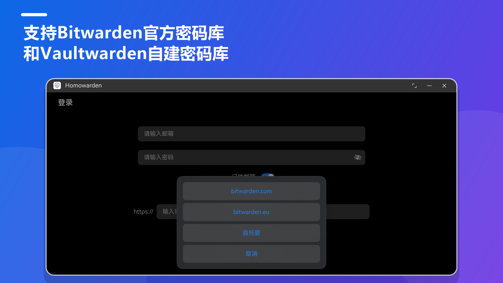
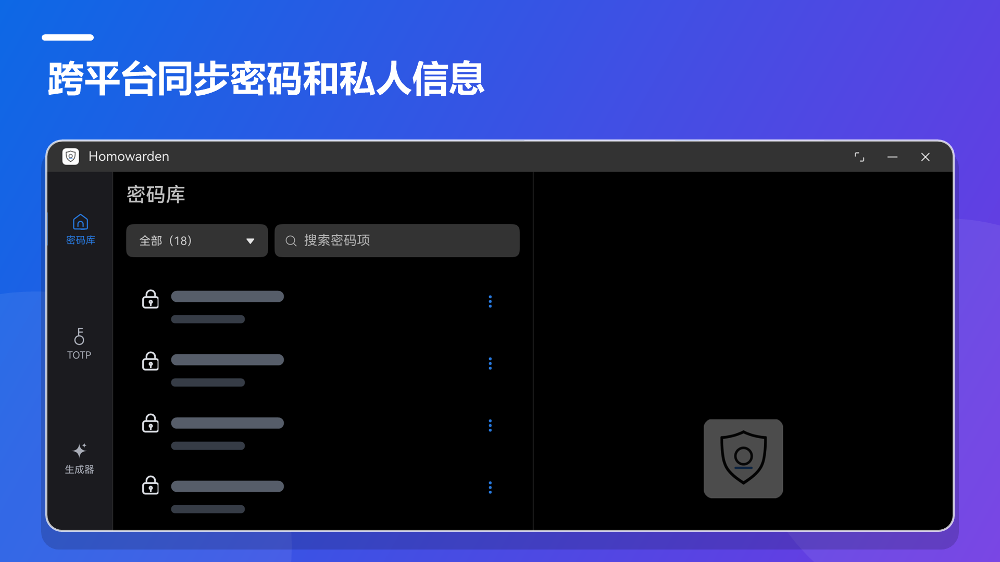
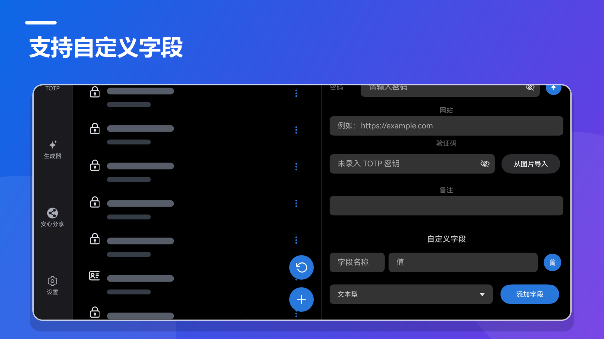
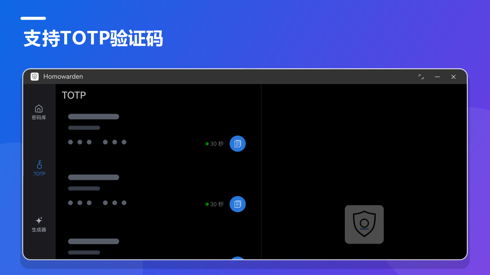
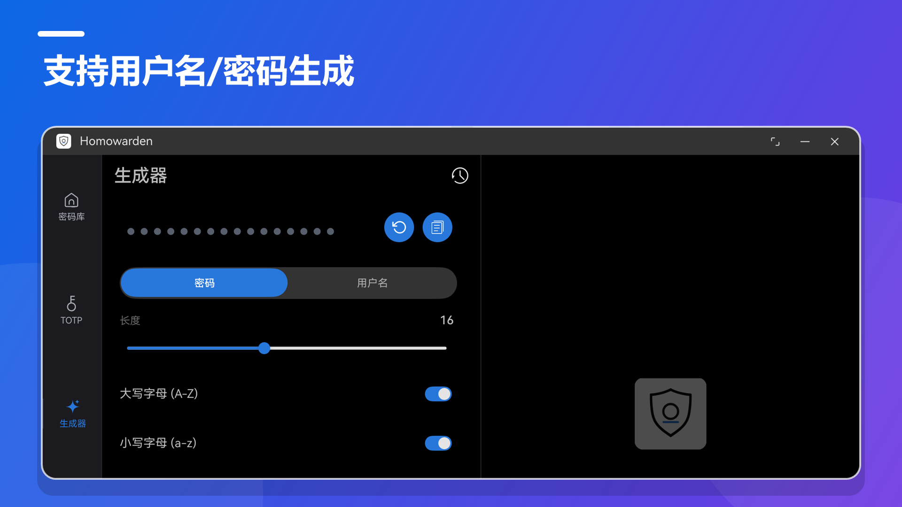
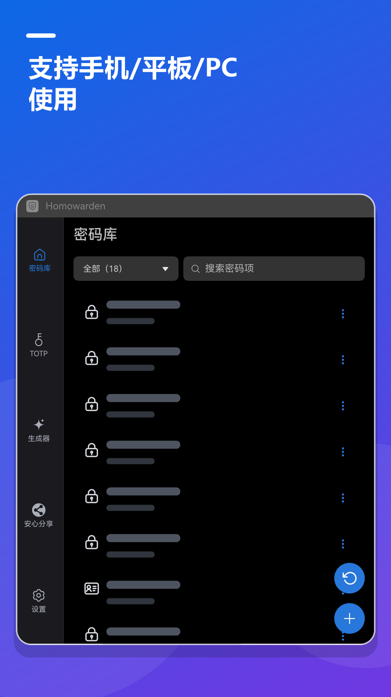

# Homowarden

[中文](README.md) | [English](README.en.md)

Homowarden 是面向 HarmonyOS 的 Bitwarden 非官方客户端，使用 ArkTS 开发，支持手机、平板和电脑。它支持官方服务器及自托管服务器，采用端到端加密保障数据安全。

**注意**：本应用的密钥存储在系统关键资产区域，不会随应用卸载而清除，在卸载本应用前请务必前往设置页面注销登录。

好消息：本应用已经上架华为应用市场(AppGallery)，欢迎下载体验

<a href="https://appgallery.huawei.com/app/detail?id=com.dreamist.homowarden&channelId=SHARE&source=appshare" target="_blank"></a>

## 功能特性

### 账户与认证

- 支持 `bitwarden.com`、`bitwarden.eu` 和自托管 Bitwarden 服务
- 支持两步验证和新设备邮箱验证



### 密码库

- 从服务端同步密码库到本地加密数据库
- 支持登录项、安全笔记、卡片、身份信息
- 支持新增、查看、编辑、删除、回收站恢复和永久删除
- 支持收藏、自定义字段、多网址和敏感条目主密码二次确认
- 支持类型、收藏、回收站筛选和关键字搜索
- 支持用户名、密码、TOTP 等常用字段快捷复制





### TOTP

- 在登录项详情和独立列表中查看动态验证码
- 解析 `otpauth://` 链接并提取密钥
- 支持扫码录入
- 在 2in1 设备上支持从图片导入 TOTP 二维码



### 密码与用户名生成器

- 使用系统安全随机源生成密码
- 支持长度、大小写字母、数字、符号和最小字符数配置
- 支持随机单词用户名和邮箱别名
- 可在新增或编辑登录项时直接生成并回填
- 保存生成历史，支持复制、单项删除和清空



### 多设备与交互

- 支持手机、平板、电脑使用
- 手机使用底部导航，宽屏设备使用侧栏导航
- 宽屏设备使用左右分栏布局
- 中英文界面，跟随系统语言
- PC端支持托盘图标和右键菜单



### 安全能力

- 支持 PBKDF2 / Argon2id
- 使用关键资产区保存敏感数据
- 主密码解锁、生物识别解锁和自动锁定
- 按设备能力启用截屏保护和防窥
- 注销时清理本地密码库、生成历史和登录凭据
- 日志会对令牌、密码等敏感信息进行脱敏

### 安心分享

- 清洗常见平台分享链接中的跟踪信息
- 支持复制完整结果或仅复制链接
- 保存分享历史，支持搜索、多选和批量删除

## 暂不支持

- 自动填充
- 密码健康检查
- 文件夹、组织、附件等更多 Bitwarden 能力
- 密码库导入导出 / 备份恢复

## 项目结构

```text
entry/src/main/ets/
├── component/          # UI 组件
├── domain/             # 领域展示映射
├── entryability/       # 应用入口 Ability
├── entrybackupability/ # 备份扩展入口
├── localization/       # 语言状态与本地化工具
├── model/              # 数据模型
├── network/            # Bitwarden 网络接口
├── pages/              # 页面
├── utils/              # 加解密、数据库、资产、链接解析等工具
└── viewmodel/          # 页面状态与业务逻辑
```

## 项目依赖

- ArkTS / ArkUI
- `@ohos/axios`
- `@huozhiniao/argon2`
- `@abner/datastore`
- `@nzy/logger`

## 注意事项

- 本项目为 Bitwarden 的非官方 HarmonyOS 实现
- 本项目尚未经过独立安全审计，不应作为密码数据的唯一备份
- 关键数据存储在关键资产区域，卸载前应先注销登录
- 自托管服务通常需要正确的 HTTPS 配置

## License

This project is licensed under the MIT License. See the LICENSE file for details.
