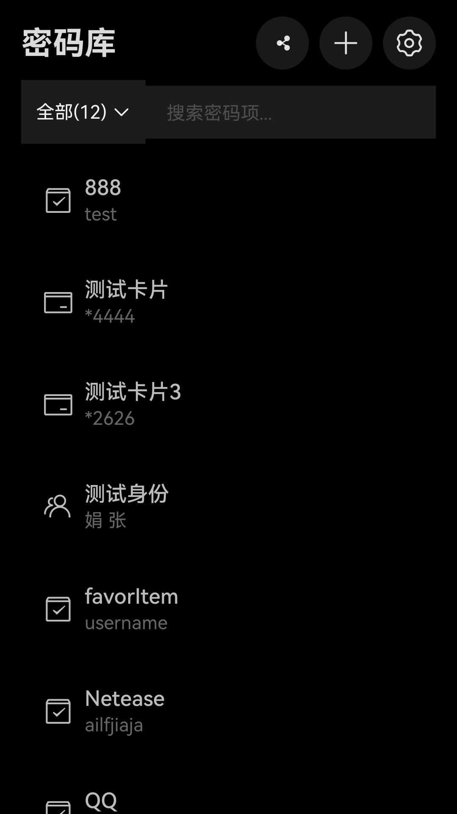
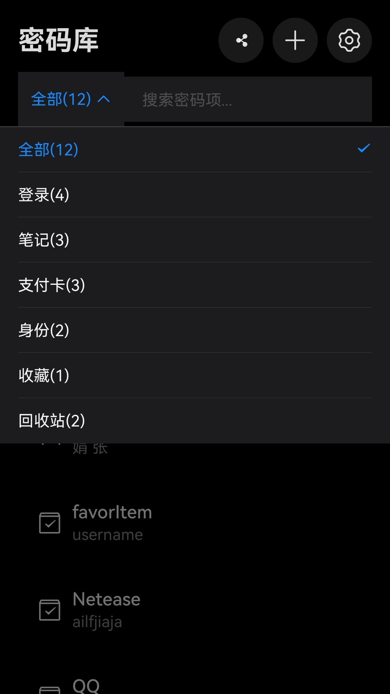
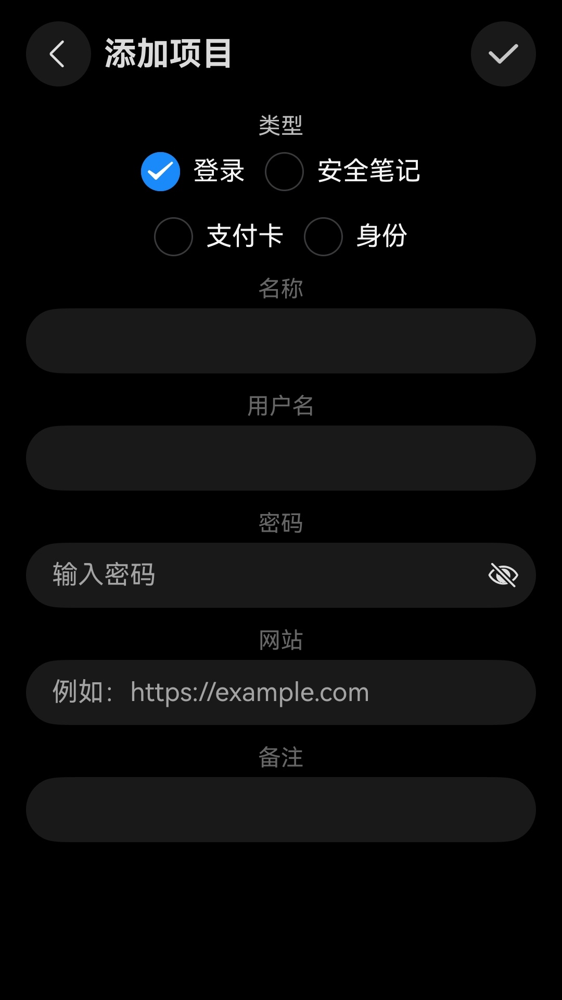
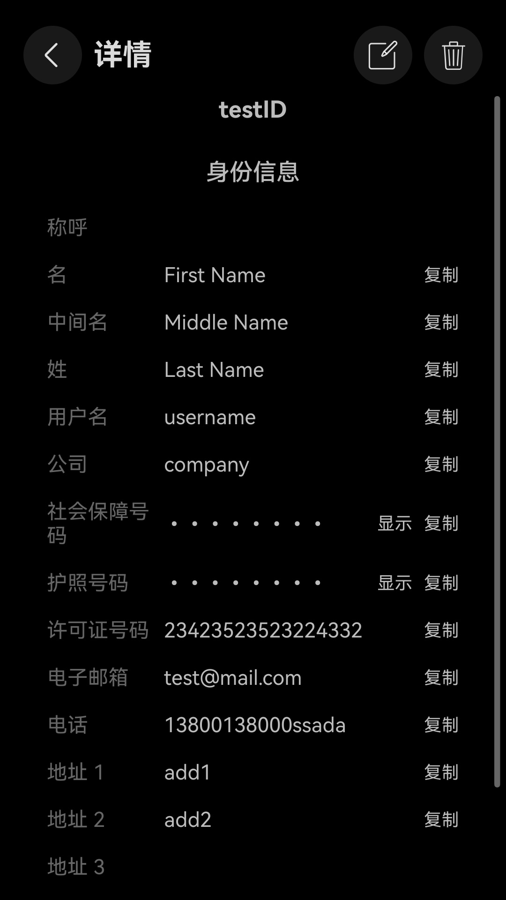
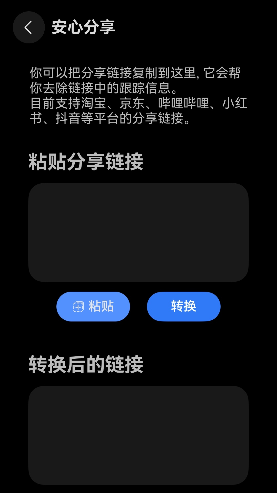

# Homowarden

Homowarden 是一个面向 HarmonyOS 的 Bitwarden 非官方客户端，使用 ArkTS 开发，支持手机、平板和 2in1 设备。它支持官方服务器及自托管服务器，采用端到端加密保障数据安全。

**注意**：本应用的密钥存储在系统关键资产区域，不会随应用卸载而清除，在卸载本应用前请务必前往设置页面注销登录。

好消息：本应用已经上架华为应用市场(AppGallery)，欢迎下载体验

## 项目现状

当前已经实现以下功能：

- Bitwarden 账户登录
- Bitwarden 官方服务器与自托管服务器接入
- 两步验证和新设备邮箱验证码流程
- 密码库从服务端拉取并同步到本地加密数据库
- 密码项的新增、查看、编辑、删除、回收站恢复
- 支持登录项、安全笔记、卡片、身份信息四类密码项
- 支持密码项收藏、自定义字段、多网址和敏感条目二次验证
- 收藏、回收站、类型筛选、关键字搜索与常用字段快捷复制
- TOTP 验证码查看、录入、编辑、删除
- 支持通过扫描 `otpauth://` 二维码录入 TOTP 密钥
- 支持在 2in1 设备上从图片导入 TOTP 二维码
- 密码与用户名生成器，以及生成历史管理
- 主密码解锁、生物识别解锁、自动锁定
- 中英文界面、无障碍语义与系统语言变化响应
- 手机底部导航、宽屏侧栏和密码库列表/详情分栏布局
- 2in1 状态栏图标、关闭至托盘和窗口会话恢复
- 脱敏日志导出与登录问题反馈入口

此外，应用还包含一个与密码库无关的实验性工具页面“安心分享”，用于清洗常见平台分享链接，并支持搜索、复制和批量删除历史记录。

## 暂不支持

自动填充、密码健康检查、文件夹等更多 Bitwarden 能力。

## 截图

## License

This project is licensed under the MIT License. See the LICENSE file for details.
